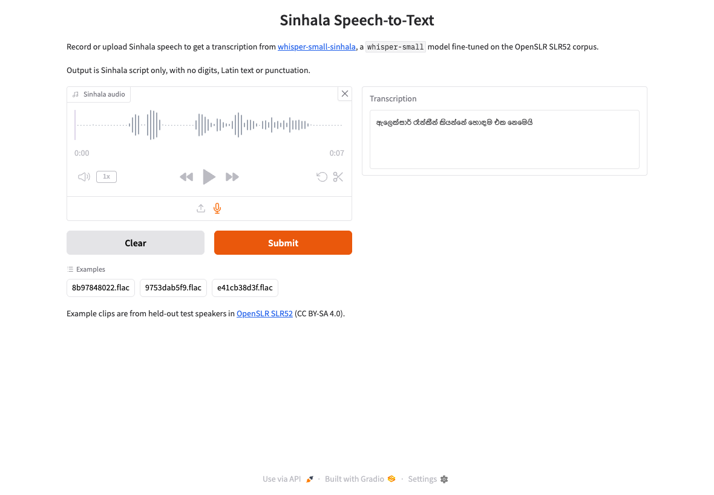
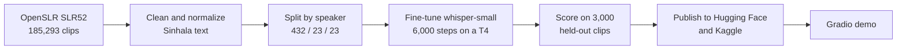
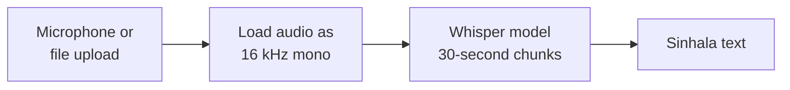
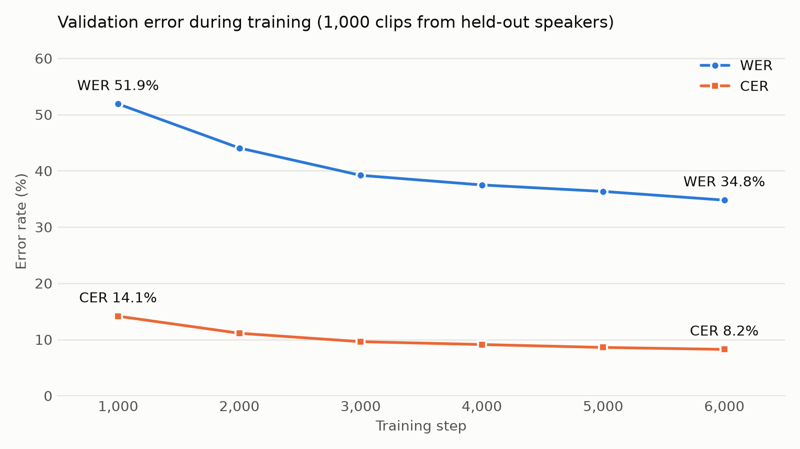

# Sinhala Speech-to-Text with Whisper

Fine-tuning OpenAI's `whisper-small` to transcribe Sinhala, trained on 194.7 hours of speech from the OpenSLR SLR52 corpus and released with a Gradio demo.

**9.13% CER and 36.47% WER** on 3,000 clips from speakers the model never heard in training. These scores are probably optimistic, because 71% of the test sentences also appear in the training data. See [Limitations](#limitations).

[](https://github.com/aadhil96/whisper-small-sinhala/actions/workflows/tests.yml)

| | |
|---|---|
| **Model on Hugging Face** | [Aadhil96/whisper-small-sinhala](https://huggingface.co/Aadhil96/whisper-small-sinhala) |
| **Model on Kaggle** | [aadhilimam/whisper-small-sinhala](https://www.kaggle.com/models/aadhilimam/whisper-small-sinhala) |
| **Demo notebook on Kaggle** | [Sinhala Speech-to-Text Gradio Demo](https://www.kaggle.com/code/aadhilimam/sinhala-speech-to-text-gradio-demo) |
| **Full write-up** | [docs/METHODOLOGY.md](docs/METHODOLOGY.md) |



## How it works



At run time, the demo does this:



## Results

Every model was scored on the same 3,000 clips with the same code and plain greedy decoding.

| Model | WER | CER | Median clip CER | Runaway outputs |
|---|---|---|---|---|
| **Fine-tuned whisper-small** | **36.47%** | **9.13%** | 6.67% | 0 |
| `whisper-large-v3`, unmodified | 340.41% | 327.51% | 94.44% | 938 |
| `whisper-small`, unmodified | 444.67% | 744.62% | 806.90% | 2,636 |

A runaway output is more than 3 times the reference length, usually a repetition loop. Error rates can pass 100% because extra words count as errors.

**The unmodified models aren't a fair comparison.** They ran without Whisper's usual fallback settings for escaping repetition loops, which inflates their numbers, so this table doesn't measure an improvement.



**Example output on a held-out clip:**

| | |
|---|---|
| **Reference** | ඇලෙක්සාර් රෑන්කින් කියන්නෙ හොදම එක නෙමෙයි |
| **Model** | ඇලෙක්සාර් රෑන්කීන් කියන්නේ හොඳම එක නෙමෙයි |

## Quick start

Use the published model:

```python
import librosa
from transformers import pipeline

asr = pipeline("automatic-speech-recognition", model="Aadhil96/whisper-small-sinhala", chunk_length_s=30)

audio, _ = librosa.load("clip.wav", sr=16000, mono=True)
result = asr({"raw": audio, "sampling_rate": 16000},
             generate_kwargs={"language": "sinhala", "task": "transcribe"})
print(result["text"])
```

Run the Gradio demo locally:

```bash
git clone https://github.com/aadhil96/whisper-small-sinhala.git
cd whisper-small-sinhala
pip install -r requirements.txt
python app/app.py
```

The first run downloads about 1 GB, and the demo works on CPU.

## Reproduce the results

Recompute every published score from the saved predictions, with no GPU or model download:

```bash
pip install -r requirements-dev.txt
python scripts/score_predictions.py
```

To retrain, push [`training/`](training) to Kaggle with a T4 GPU and internet enabled. The full run takes about 8 hours.

```bash
kaggle kernels push -p training --accelerator NvidiaTeslaT4
```

## Testing

```bash
pytest                         # fast tests with a stand-in model
pytest -m slow                 # the real model from Hugging Face
python scripts/e2e_ui_check.py # the real Gradio page in Chrome
```

What's covered, and what isn't, is in [docs/TESTING.md](docs/TESTING.md).

## Limitations

- **Sentence overlap:** speakers are kept separate, but 2,125 of the 3,000 test sentences also appear in training. Results on new sentences are likely worse, and that hasn't been measured.
- **Output:** Sinhala script only, with no digits, Latin text or punctuation.
- **Conditions:** it hasn't been evaluated on noisy audio, phone calls, heavy code-switching with English, or across dialects.
- **Dropped data:** 6,865 clips dropped out while matching audio to transcripts, and the cause hasn't been investigated.

## Repository layout

```text
app/app.py                     Gradio demo
src/sinhala_asr/               Text normalization and scoring
training/                      The exact Kaggle script used for the published model
demo/                          The Kaggle Gradio notebook
results/                       Scores, training log and every test prediction
examples/                      Three held-out clips with their reference text
scripts/                       Rescoring, figures and the browser check
tests/                         Automated tests
docs/                          Methodology, testing notes and images
```

## Licence

The code is MIT. The model, example audio and saved transcripts are CC BY-SA 4.0 because they derive from OpenSLR SLR52. See [NOTICE.md](NOTICE.md).
