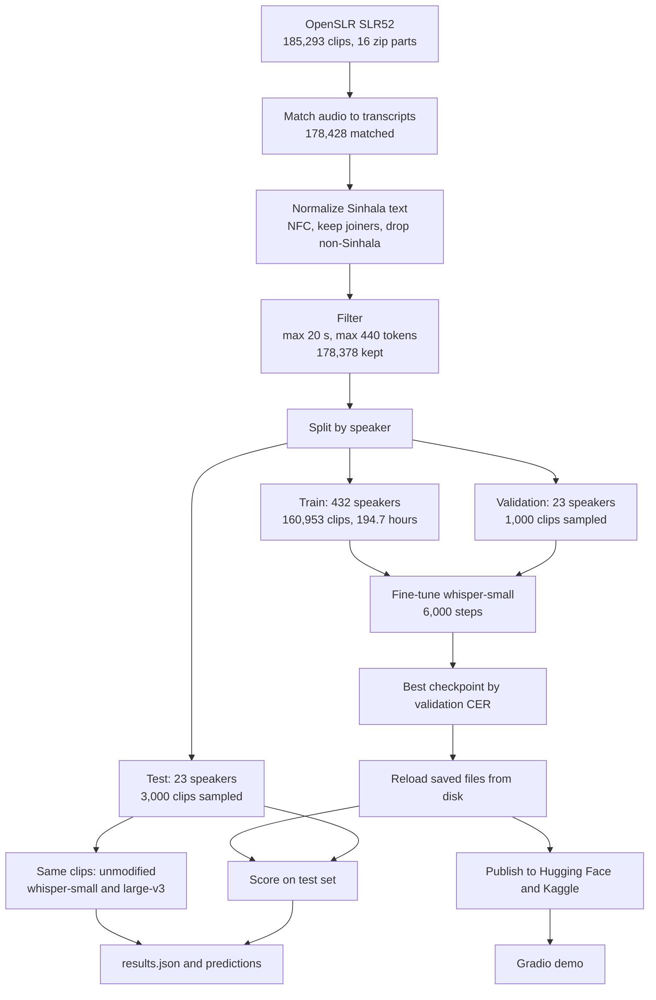
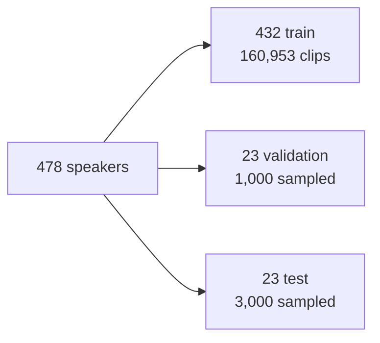
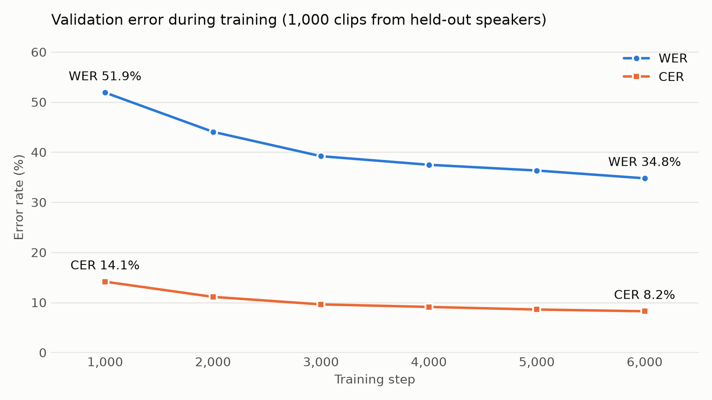

# Methodology

How the model was built, and why each decision was made. Numbers are from [`results/results.json`](../results/results.json).

## End-to-end pipeline



## 1. Data

**Corpus:** [OpenSLR SLR52](https://www.openslr.org/52/), Large Sinhala ASR training data set, CC BY-SA 4.0. It's about 15 GB across 16 zip parts.

| Stage | Clips |
|---|---|
| FLAC files in the corpus | 185,293 |
| Matched to a non-empty normalized transcript | 178,428 |
| Kept after the length filters | 178,378 |

**Known gap:** 6,865 clips dropped out at the matching and normalization step. The cause hasn't been investigated.

## 2. Text normalization

Implemented in [`src/sinhala_asr/text.py`](../src/sinhala_asr/text.py). Sinhala needs specific care here:

1. **Unicode NFC**, so identical-looking text uses the same code points.
2. **Remove zero-width non-joiners** (U+200C).
3. **Keep zero-width joiners** (U+200D) in training labels. Sinhala conjuncts need them, and removing them makes "ශ්‍රී" display incorrectly. The original notebook removed them, and this was changed before training. 27,771 of the kept transcripts contain one.
4. **Remove everything outside the Sinhala Unicode block**, including digits, Latin text and punctuation.

Joiners are removed only at scoring time, so no model is penalized for an invisible character.

**Consequence:** the model can only write Sinhala script. It can't produce numbers, English words or punctuation.

## 3. Train, validation and test split

The split is by speaker, so nobody in validation or test appears in training. Speakers are shuffled with a fixed seed (42), and 5% go to each of validation and test.



**Sentences are not kept separate.** 2,125 of the 3,000 test sentences (71%) also appear in training, spoken by other people, because the corpus reuses sentences. See [Limitations](#7-limitations).

## 4. Model and training

Implemented in [`training/train_whisper_sinhala.py`](../training/train_whisper_sinhala.py), which ran as a single script on Kaggle.

| Setting | Value |
|---|---|
| Base model | `openai/whisper-small` |
| Language and task | Sinhala, transcribe |
| Steps | 6,000, about 0.6 of an epoch |
| Batch size | 16 |
| Learning rate | 1e-5, with 400 warmup steps |
| Precision | Mixed (`fp16`), with gradient checkpointing |
| Hardware | One NVIDIA Tesla T4 on Kaggle |
| Checkpoint selection | Lowest validation CER, checked every 1,000 steps |

These changes from the first notebook version let a long run finish safely on Kaggle:

| Problem | Decision |
|---|---|
| Caching audio features for the whole corpus would be far too large | Compute features on the fly in the data loader |
| Sinhala needs about 2 tokens per character, so a 225-token limit could cut off long sentences | Allow up to 400 new tokens |
| Kaggle can end a session and outputs may be lost | Stop training at a time limit and save the model before scoring |
| Saved files could differ from the model in memory | Reload the fine-tuned model from disk for the final score |

The run took 8.2 hours: about 1.9 for download, 4.4 for training and 1.9 for scoring.



Validation error was still falling at the final step, so more training might help further.

## 5. Evaluation

Every model was scored on the same 3,000 clips, with the same code and plain greedy decoding.

- **WER** is word error rate and **CER** is character error rate, both using [jiwer](https://github.com/jitsi/jiwer) after `normalize_score`.
- **Median clip CER** shows the typical clip, because a few repetition loops can inflate the averages.
- **Runaway outputs** count hypotheses more than 3 times longer than the reference, usually a repetition loop.

Every prediction is saved in [`results/`](../results), so the scores can be recomputed:

```bash
python scripts/score_predictions.py
```

## 6. Results

| Model | WER | CER | Median clip CER | Runaway outputs |
|---|---|---|---|---|
| **Fine-tuned whisper-small** | **36.47%** | **9.13%** | 6.67% | 0 |
| `whisper-large-v3`, unmodified | 340.41% | 327.51% | 94.44% | 938 |
| `whisper-small`, unmodified | 444.67% | 744.62% | 806.90% | 2,636 |

Treating clips as independent, a bootstrap gives a 95% interval for WER of about 35.4% to 37.6%. The real uncertainty is larger, because the test set has only 23 speakers.

**WER looks high next to CER** because clips are short, with a median of 4 words, so one wrong letter counts as a whole wrong word. Some errors are only word spacing, such as `වැඩි දියුණු` versus `වැඩිදියුණු`. 823 of the 3,000 clips were transcribed exactly right.

## 7. Limitations

- **Sentence overlap:** 71% of test sentences also appear in training, so scores are probably better than they would be on new text. No score on unseen sentences alone has been measured.
- **Baselines aren't a fair comparison:** the unmodified models ran without Whisper's usual fallback settings for escaping repetition loops, which inflates their error rates. Even excluding runaway clips, `large-v3` scores about 111% WER and 87% CER, but **these numbers shouldn't be read as an improvement claim**.
- **Recording conditions:** it has not been evaluated on noisy audio, phone calls, heavy code-switching with English, or across dialects and speaker groups.
- **Output:** Sinhala script only.
- **Long audio:** training clips were at most 20 seconds. The demo splits longer audio into 30-second chunks, which hasn't been separately evaluated.

## Design decisions

- **Why a speaker-disjoint split?** Otherwise the model can score well by recognizing voices it has already heard.
- **Why pick the checkpoint by CER?** Sinhala words are long and word spacing varies, so CER reflects quality better than WER here.
- **Why plain greedy decoding?** It's simple and the same for every model, but it's also the reason the baselines can't be fairly compared.

## What would improve this

1. Score on sentences that never appear in training.
2. Re-run the baselines with Whisper's fallback settings.
3. Investigate the 6,865 dropped clips.
4. Train for longer, since validation error was still falling.
