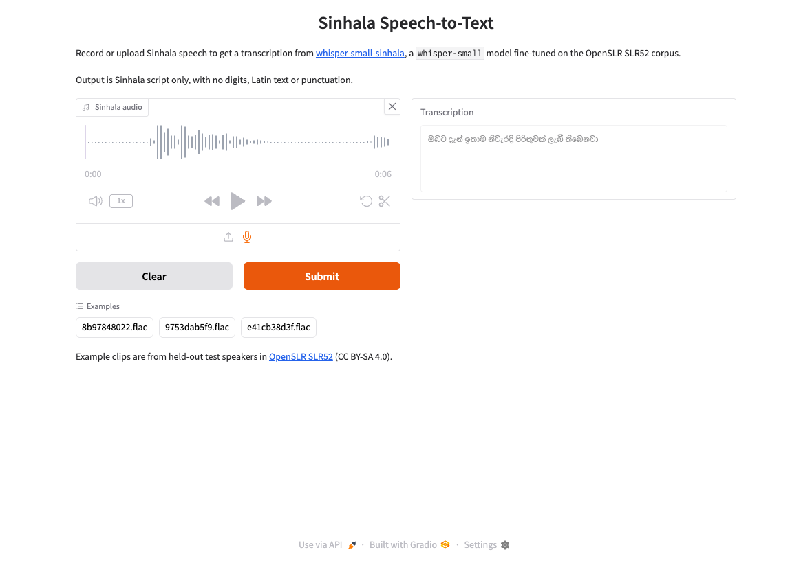

# Testing

There are three levels of tests, from fast to most realistic.

| Level | Command | What it uses | Time |
|---|---|---|---|
| **Fast** | `pytest` | A stand-in model, so nothing is downloaded. This also runs on every push via GitHub Actions. | About 1.5 minutes |
| **Real model** | `pytest -m slow` | The published model from Hugging Face, about 1 GB | About 2 minutes after the download |
| **Browser** | `python scripts/e2e_ui_check.py` | The real model and the real Gradio page in Google Chrome | About 3 minutes |

## Fast tests

| File | What it checks |
|---|---|
| [`test_text.py`](../tests/test_text.py) | Sinhala normalization: joiners kept for training and removed for scoring, non-Sinhala text removed, NFC |
| [`test_metrics.py`](../tests/test_metrics.py) | WER and CER on known cases, skipped empty references, and repetition loops |
| [`test_results.py`](../tests/test_results.py) | Every published score recomputes from the saved predictions, and all models were scored on the same clips |
| [`test_training_script.py`](../tests/test_training_script.py) | The Kaggle script's copy of the normalization matches the package, and it's set up for the full run |
| [`test_app.py`](../tests/test_app.py) | The Gradio app: empty input, resampling stereo 44.1 kHz audio, unreadable files, and requests through a running server |

## Real-model tests

[`test_model_integration.py`](../tests/test_model_integration.py) downloads `Aadhil96/whisper-small-sinhala` and transcribes the three held-out clips in [`examples/`](../examples), directly and through a running Gradio server. Each clip must score under 30% CER.

| Clip | Reference | Model output | CER |
|---|---|---|---|
| `8b97848022` | ඇලෙක්සාර් රෑන්කින් කියන්නෙ හොදම එක නෙමෙයි | ඇලෙක්සාර් රෑන්කීන් කියන්නේ හොඳම එක නෙමෙයි | 7.3% |
| `9753dab5f9` | එක්තරා උදෑසනක ට පමණ කරන ලද ස්කෑන් එකකින් | එක්තරා උදෑසනකට පමණව කරන ලද විස්කෑන් එකකි | 15.0% |
| `e41cb38d3f` | ඔබට දැන් ඉතාම නිවැරැදි පිළිතුරක් ලැබී තිබෙනවා | ඔබට දැන් නිතාම නිවැරදි පිරිතුරක් ලැබී තිබෙනවා | 8.9% |

## Browser check

[`scripts/e2e_ui_check.py`](../scripts/e2e_ui_check.py) opens the real page in Chrome and tests three ways of giving the app audio:

1. **Example:** clicks a built-in example clip and submits it.
2. **Upload:** uploads an audio file.
3. **Microphone:** records with a simulated microphone. Chrome plays a held-out clip as its microphone, so this tests recording, upload and transcription in the browser.

It also fails if the page shows any JavaScript errors.

**Latest results:** 3 of 5 runs passed all three flows.

| Flow | CER in passing runs |
|---|---|
| Example | 7.3% |
| Upload | 15.0% |
| Microphone | 6.7% to 13.3%, because the recording starts at a different point each time |

**Both failures happened while the Mac running the tests was asleep.** It was on battery with the lid closed, and macOS slept for about 15 minutes at a time. The failures and the stalls match its sleep log to within seconds, while the Gradio server answered in 3–85 ms right after each stall. Run the browser check with the lid open or on power.

## Not yet tested

- **A person speaking into a real microphone.** The simulated microphone uses a recorded clip, so it can't show how the model handles room noise, different microphones or natural speech.
- **Browsers other than Chrome.**
- **Audio longer than 30 seconds**, which the app splits into chunks.
- **The Hugging Face Space deployment.** Gradio Spaces need a paid account, so the demo runs as a [Kaggle notebook](https://www.kaggle.com/code/aadhilimam/sinhala-speech-to-text-gradio-demo) instead.
